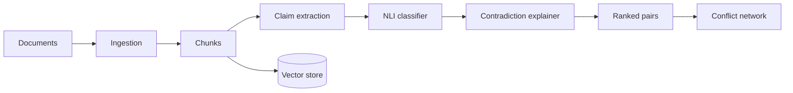

<div align="center">

# Contradiction Finder

**Find the sentences in a corpus that cannot both be true.**

[](https://adineo-cmd2.github.io/contradiction-finder/)
     

[](https://github.com/adineo-cmd2/contradiction-finder/stargazers) [](https://github.com/adineo-cmd2/contradiction-finder/commits)

[Live site](https://adineo-cmd2.github.io/contradiction-finder/) · [Quick start](#quick-start) · [How it works](#how-it-works) · [Features](#features)

</div>

---

Load documents, extract their claims, and the engine surfaces pairs that
contradict each other — with the evidence spans that create the conflict and a
network view of how the conflicts connect.

The room is called **ContraLens** inside Atrium.

## Features

| | Feature | What it does |
| --- | --- | --- |
| 📄 | **Corpus management** | Group documents into corpora and inspect each one on its own page. |
| ✂️ | **Claim extraction** | Pulls atomic claims with the exact evidence span behind them. |
| ⚖️ | **Ranked conflicts** | NLI scoring ranks contradictory pairs by severity, not alphabetically. |
| 🕸️ | **Conflict network** | Plots claims and contradiction edges as one graph. |

## How it works

The pipeline is deliberately split so each stage can be inspected:

1. **Ingest** — documents are parsed, chunked and embedded.
2. **Extract** — claims are pulled out with source spans.
3. **Classify** — an NLI classifier scores candidate pairs for contradiction.
4. **Explain** — the explainer writes why the pair conflicts.
5. **Build** — the network builder turns records into the graph view.



## Quick start

Backend needs Python 3.11+ and a virtualenv. Frontend needs Node 18+.

**Backend**

```bash
cd backend
python3 -m venv .venv && source .venv/bin/activate
pip install -r requirements.txt
cp .env.example .env          # add a provider key for live model calls
python3 -m uvicorn app.main:app --reload --port 8003
```

**Frontend**

```bash
cd frontend
npm install
npm run dev                   # http://localhost:4323
```

**Tests**

```bash
python3 -m pytest backend/tests/ -v
```

## Project structure

```text
backend/
  app/
    main.py        FastAPI app and router mounting
    api/           request dependencies
    models/        SQLAlchemy tables
    schemas/       Pydantic request/response models
    services/      the analysis pipeline
  tests/           pytest suite
frontend/
  src/pages/       Astro routes
  src/lib/         API client and shared helpers
```

## Configuration

| Variable | Default | Purpose |
| --- | --- | --- |
| `DATABASE_URL` | `sqlite:///./contra.db` | Per-app SQLite database |
| `JWT_SECRET` | `dev-only-change-me` | Session token signing |
| `ANTHROPIC_API_KEY` | (empty) | Anthropic provider for live analysis |
| `OPENAI_API_KEY` | (empty) | OpenAI provider for live analysis |
| `FRONTEND_ORIGIN` | `http://localhost:4323` | Allowed CORS origin |

## Deployment

The frontend is a static build and deploys to GitHub Pages on every push
to `main` through `.github/workflows/deploy.yml`:

**https://adineo-cmd2.github.io/contradiction-finder/**

The backend is not part of that deployment. Run it yourself, then point the
frontend's API base at it.

## Part of the suite

This app is one of ten independent rooms in
**[Atrium](https://github.com/adineo-cmd2/atrium)**. Each room has its own
backend, SQLite database, search index and frontend; the portal only links them.

- [Unknown Research Engine](https://github.com/adineo-cmd2/unknown-research-engine) — maps open questions.
- [Cognitive Bias Detector](https://github.com/adineo-cmd2/cognitive-bias-detector) — names the bias in a passage.
- [Socratic Debate Partner](https://github.com/adineo-cmd2/socratic-debate-partner) — stresses a single argument.

## Contributing

Issues and pull requests are welcome. For anything larger than a typo or a
small fix, open an issue first so the approach can be agreed before the work.

- Bugs and ideas: [issues](https://github.com/adineo-cmd2/contradiction-finder/issues)
